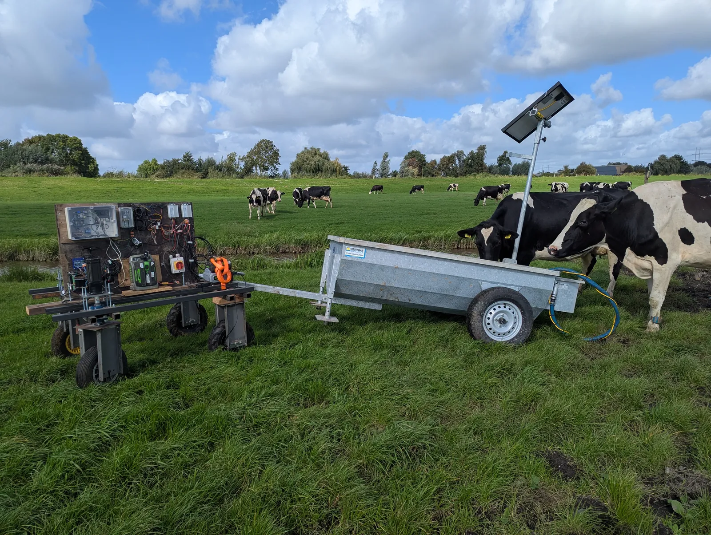
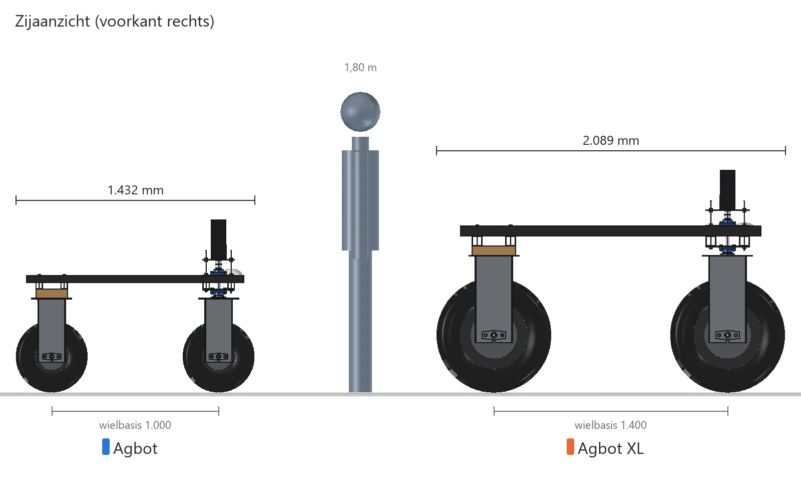
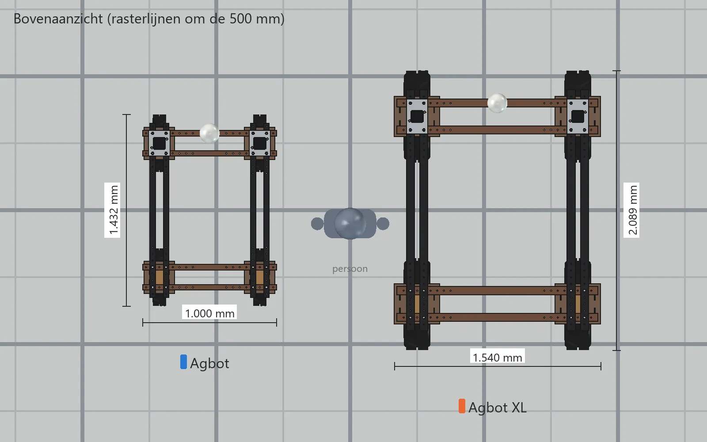
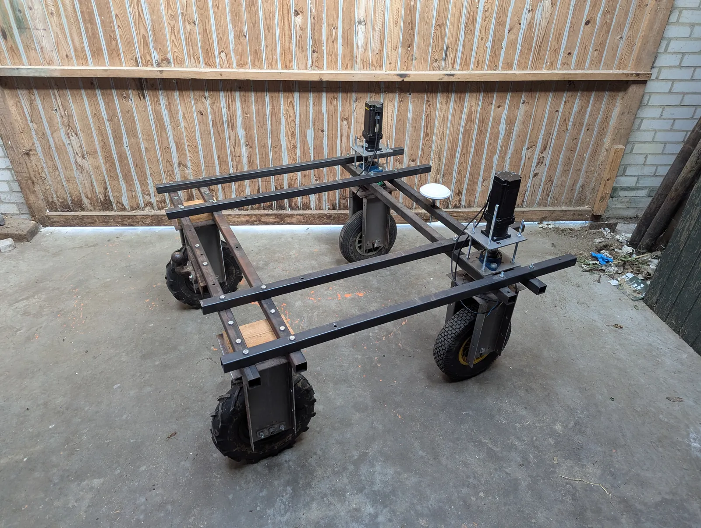
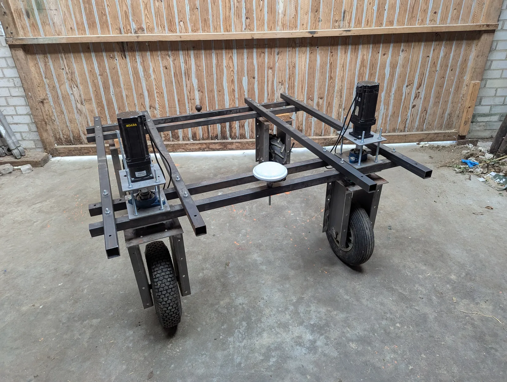
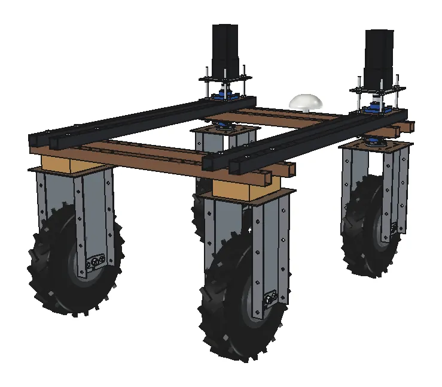
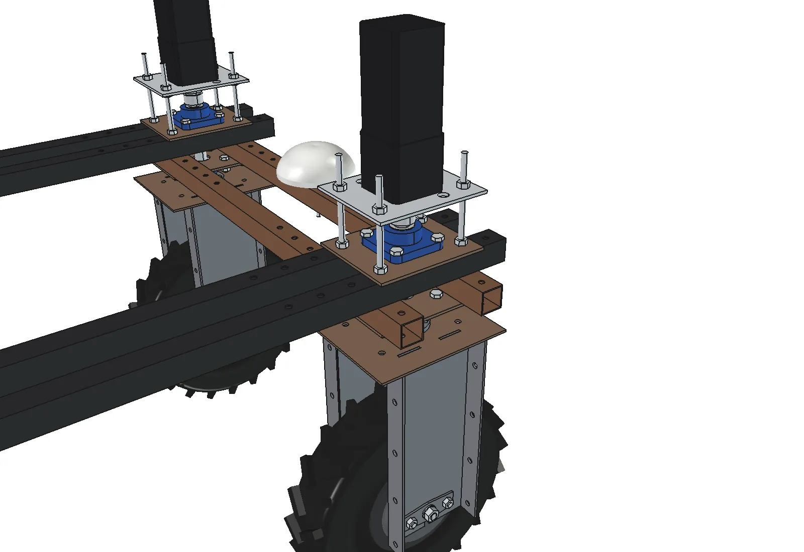
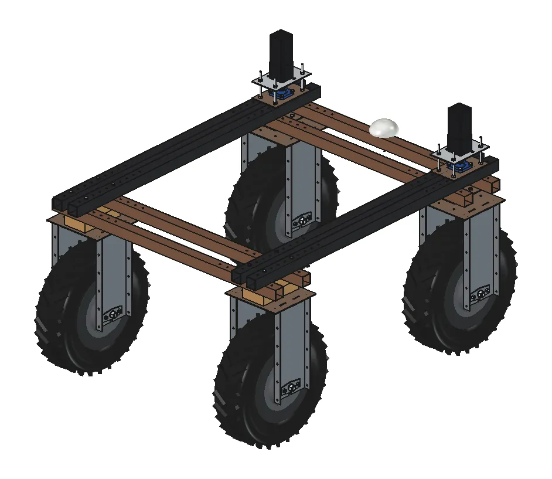

# openagbot-CADdesigns

CAD designs for the open-source OpenAgbot robots. Every robot has its own folder with an OpenSCAD design and a
FreeCAD model.



| Robot | Description | Status |
| --- | --- | --- |
| [robot Bruut](robot%20Bruut) | The small standard robot: 750 x 1000 mm, 8" 48 V hub motors, 2WD or 4WD. Almost all designs live here. | Active |
| [robot Ekko](robot%20Ekko) | The larger variant (Agbot XL on the website): 16" 60 V hub motors, 1200 x 1400 mm, 60 mm box beams. | Folders prepared, designs follow |

| | Bruut 2WD | Bruut 4WD | Ekko 2WD | Ekko 4WD |
| --- | --- | --- | --- | --- |
| Hub motor | Quinder 8" 48 V 550 W | Quinder 8" 48 V 550 W | Quinder 16" 60 V 2100 W | Quinder 16" 60 V 2100 W |
| Driven wheels | 2 (rear) | 4 | 2 (rear) | 4 |
| Motor power | 1.1 kW | 2.2 kW | 4.2 kW | 8.4 kW |
| Track x wheelbase | 750 x 1000 mm | 750 x 1000 mm | 1200 x 1400 mm | 1200 x 1400 mm |
| Tyre (diameter x width) | 430 x 100 mm | 430 x 100 mm | 686 x 198 mm | 686 x 198 mm |
| Box beam | 40 mm | 40 mm | 60 mm | 60 mm |
| Kerb weight | 151 kg | 162 kg | 392 kg | 430 kg |
| Net pulling force (dry grass) | 27 kgf | 82 kgf | 88 kgf | 224 kgf |
| Top speed | 6 km/h | 6 km/h | 11.4 km/h | 11.4 km/h |

Indicative figures from the [project website](https://jacobsfarm.github.io/Bruut_openagbot_website/), where the four
versions are compared in full, including prices. Same frame concept and same software for all four.

 

Related repositories: [Bruut_OpenAgbot](https://github.com/JacobsFarm/Bruut_OpenAgbot) (robot software),
[Bruut_OpenAgbot_Implements](https://github.com/JacobsFarm/Bruut_OpenAgbot_Implements) (implements: mower bar,
dock-weed drill, liquid manure injector, overseeder) and the
[project website](https://jacobsfarm.github.io/Bruut_openagbot_website/).

## Repository layout

```
openagbot-CADdesigns/
├── AGENTS.md          rules for contributors and AI assistants
├── LICENSE            GNU AGPL v3
├── robot Bruut/
│   ├── openscad/      parametric design: parts, assemblies, laser-cut and drill files
│   └── freecad/       FreeCAD model, generated by Python scripts
└── robot Ekko/
    ├── openscad/
    └── freecad/
```

Every robot follows the same two-folder pattern, so a file always lives at `robot <name>/<tool>/...`. Nothing is
shared between robots: Ekko gets its own `parameters.scad` instead of reusing the one of Bruut.

## How the two tools relate

| | `openscad/` | `freecad/` |
| --- | --- | --- |
| Role | The source design: parametric parts, assemblies, laser-cut plates and drill templates | A realistic model of the robot as built, for checking fit and showing it |
| Dimensions | `config/parameters.scad` | `agbot_params.py`, a mirror of `parameters.scad` with the same names and values |
| Edit by | Changing the `.scad` files | Changing the Python scripts. The `.FCStd` is generated, never edited by hand |
| Output | DXF for laser cutting, STL for drill jigs and printing | `.FCStd`, preview images and an animation |

The FreeCAD model is built from the OpenSCAD parts: the main plates, beams and brackets are exact copies (volume
differs less than 0.01 % from an OpenSCAD STL export). Things that only exist on the real robot, such as the steering
head and stepper motors, are added in FreeCAD from photos. When you change a dimension in OpenSCAD, change it in
`agbot_params.py` too and regenerate the model.

## Robot Bruut

### OpenSCAD

Volume 2 of the design: a redesign with better alignment and a stronger, more realistic build.


All dimensions come from `config/parameters.scad`, in a 50 mm grid. Chassis width and length are adjustable within
set ranges (350-850 mm wide, 700-1100 mm long). Parts feed assemblies and assemblies feed the main assemblies. Open
`main_assembly_2wd.scad` or `main_assembly_4wd.scad` to see the robot.

The chassis is a hole-grid frame of box beams, so track width and wheelbase are set by bolting the beams into a
different row of holes, without welding. Each wheel module (hub motor, 2 side plates, top plate with slotted holes) is
laser cut: 8 side plates, 8 axle brackets and 4 top plates for the whole robot. The drawings are in this repo, so any
sheet metal shop can make them.

Besides the robot itself the folder holds the printable drill templates and bushings, and mounts for a Daheng camera
and a USB2CAN converter. The hub motor, tyre and reducer STLs are not in the repo: see `imports/notes.txt` for where to
get them.

Full layout and file descriptions: [robot Bruut/openscad/README.md](robot%20Bruut/openscad/README.md).

### The built robot

 

Every part of the design has been built and driven, with the electronics deliberately left visible.

### FreeCAD

FreeCAD 1.1 model with 2 fixed hub-motor wheels at the rear and 2 steered hub-motor wheels at the front, each with a
NEMA34 stepper motor on a 5:1 planetary gearbox above it.

 

Each front wheel turns on its own steering shaft (flange bearings above and below the frame). The scripts can also steer the model with Ackermann angles and render an animation of the robot driving and turning
(`previews/animation_drive_turn.gif`). Open `run_in_freecad.py` in FreeCAD and run it (F6) to rebuild the model.

Details, assumptions and what is estimated from photos: [robot Bruut/freecad/README.md](robot%20Bruut/freecad/README.md)
(in Dutch).

## Robot Ekko



Ekko is the larger variant of Bruut: the same frame concept and software with 16" hub motors (200/70R16 tyres),
60 mm box beams, a 1200 mm track and a 1400 mm wheelbase. The turning radius is about 40% larger than Bruut's. Its
`openscad/` and `freecad/` folders are empty for now. Start from a copy of the Bruut files and change the dimensions
in Ekko's own `parameters.scad` and `agbot_params.py`.

## Working in this repo

- OpenSCAD and FreeCAD 1.1 are needed to open the designs. All dimensions are in millimetres.
- Rules for code style, symmetry, laser-cut output and AI assistants are in [AGENTS.md](AGENTS.md).
- Licensed under the GNU Affero General Public License v3, see [LICENSE](LICENSE).
